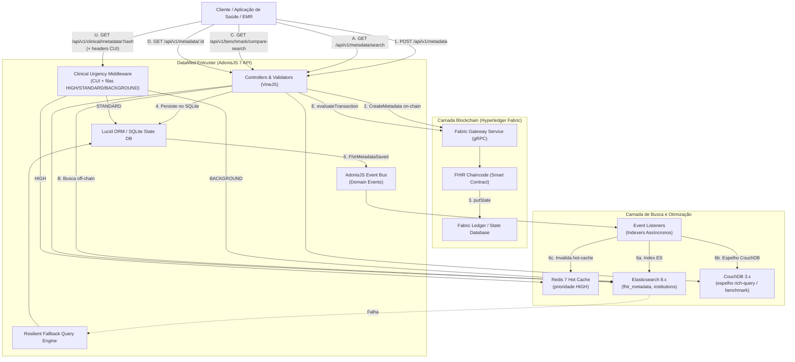

# DataMed Entruster (Interopchain)

> Plataforma de custódia e interoperabilidade de metadados em saúde (FHIR) com garantia de integridade em Blockchain permissionada (Hyperledger Fabric), otimização de consultas via Elasticsearch e roteamento por urgência clínica (Redis + CUI).

[](https://nodejs.org/)
[](https://adonisjs.com/)
[](https://www.hyperledger.org/projects/fabric)
[](https://www.elastic.co/)
[](https://redis.io/)
[](https://couchdb.apache.org/)
[](https://www.typescriptlang.org/)
[](LICENSE)

---

## 📌 Contexto da Aplicação & Motivação

O **DataMed Entruster** é parte integrante da pesquisa de Mestrado do projeto **Interopchain**, focado nos seguintes eixos científicos e práticos:

1. **Estruturação e Modelagem de Metadados de Dados Clínicos**: Em conformidade com o padrão internacional **HL7 FHIR** (_Fast Healthcare Interoperability Resources_), a aplicação gerencia metadados clínicos e seus respectivos hashes criptográficos (SHA-256), registrando-os em ledger distribuído para assegurar integridade, autenticidade, rastreabilidade e não-repúdio, ao mesmo tempo em que preserva a privacidade dos dados clínicos sensíveis (que permanecem armazenados de forma off-chain).
2. **Otimização do Tempo de Leitura em Blockchains Permissionadas**: A consulta e agregação de dados diretamente em livros-razão de blockchains (como `getStateByRange` ou varreduras em nós de validação) impõem gargalos severos de throughput e latência. O projeto soluciona esse desafio adotando o padrão arquitetural de **leitura otimizada off-chain (CQRS / Off-chain Indexing)** utilizando **Elasticsearch** sincronizado por eventos de domínio assíncronos, com mecanismo de fallback resiliente para banco relacional. O **CouchDB** espelha os mesmos documentos para benchmark de rich-query (análogo ao state DB do Fabric) versus o índice off-chain.
3. **Master Patient Index (MPI) e Identificação Cruzada**: Gestão unificada de identidades de pacientes com suporte a múltiplos identificadores clínicos por instituição de saúde (e.g., CPF, Cartão Nacional de Saúde - CNS, prontuários locais de hospitais e clínicas).
4. **Clinical Urgency Routing (CUI)**: Priorização de leituras clínicas com base no *Clinical Urgency Index* — emergência usa Redis hot-cache; tráfego administrativo/auditoria é desviado para Elasticsearch, isolando latência crítica.

---

## 🏗️ Arquitetura da Solução



### Principais Pilares da Arquitetura

- **Write Path (Garantia de Integridade)**: Ao receber um metadado FHIR (`POST /api/v1/metadata`), o sistema submete a transação à blockchain via `FabricGatewayService`. Em seguida, persiste o registro no banco local, acionando o evento `FhirMetadataSaved`.
- **Read Path (Busca Otimizada)**: As buscas (`GET /api/v1/metadata/search` e `GET /api/v1/institutions/search`) são processadas pelo **Elasticsearch**, fornecendo busca textual `multi_match` com wildcard e fuzziness, filtros exatos por atributos clínicos (`resourceType`, `status`, `patientId`, `institutionId`), intervalos temporais (`updatedAt`) e paginação.
- **Resiliência e Fallback Transparente**: Se o nó do Elasticsearch estiver inacessível, a aplicação ativa silenciosamente o fallback no banco relacional via Lucid ORM, garantindo alta disponibilidade da API sem indisponibilidade para o usuário final.
- **Clinical Urgency Routing**: Middleware calcula o *Clinical Urgency Index* (CUI) a partir dos headers `X-Encounter-Class`, `X-FHIR-Resource` e `X-User-Role`. Alta prioridade lê do Redis hot-cache; média do State DB (SQLite); baixa (auditoria) do Elasticsearch. CouchDB espelha metadados para benchmark de rich-query vs ES (`GET /api/v1/benchmark/compare-search`).
- **Ambiente de Blockchain**:
  - **Test-Network (`fabric-samples`)**: Rede com Org1MSP + Org2MSP, canal `mychannel` e chaincode `fhir_chaincode`, provisionada automaticamente por `fabric-bootstrap` no `docker compose up`.
  - **Microfab (`ibp-microfab`)**: Ainda suportado pela API se `FABRIC_MODE=microfab` (não faz mais parte do Compose padrão).

---

## 💻 Tecnologias Empregadas

- **Linguagem & Runtime**: [Node.js](https://nodejs.org/) (v22/v24), [TypeScript](https://www.typescriptlang.org/) (ESM).
- **Framework Web**: [AdonisJS v7](https://adonisjs.com/) (com IoC container, routing, middleware e event emitter).
- **Rede Blockchain**: [Hyperledger Fabric v2.x](https://www.hyperledger.org/projects/fabric), [@hyperledger/fabric-gateway](https://www.npmjs.com/package/@hyperledger/fabric-gateway), `@grpc/grpc-js`.
- **Smart Contract (Chaincode)**: TypeScript com `fabric-contract-api` e `fabric-shim`.
- **Mecanismo de Busca**: [Elasticsearch 8.x](https://www.elastic.co/) (`@elastic/elasticsearch`).
- **Hot Cache (CUI HIGH)**: [Redis 7](https://redis.io/) via [`ioredis`](https://github.com/redis/ioredis).
- **Espelho Rich-Query / Benchmark**: [Apache CouchDB 3.x](https://couchdb.apache.org/) via [`nano`](https://github.com/apache/couchdb-nano) (consultas Mango).
- **Banco de Dados & ORM**: [Lucid ORM](https://lucid.adonisjs.com/) com [Better-SQLite3](https://github.com/WiseLibs/better-sqlite3) (com suporte integrado para PostgreSQL, MySQL, SQL Server ou libSQL).
- **Validação de Dados**: [VineJS](https://vinejs.dev/).
- **Autenticação**: [@adonisjs/auth](https://docs.adonisjs.com/guides/auth/introduction) com Access Tokens (Bearer).
- **Ambiente Containerizado**: [Docker](https://www.docker.com/) e [Docker Compose](https://docs.docker.com/compose/).
- **Suíte de Testes**: [Japa](https://japa.dev/) (unitário/funcional) e [k6](https://k6.io/) (carga emergência vs auditoria).

---

## 📁 Estrutura de Diretórios

```text
datamed_entruster/
├── app/
│   ├── controllers/            # Metadata, ClinicalQuery, Benchmark, Institutions, Patients, Auth
│   ├── events/                 # FhirMetadataSaved, InstitutionSaved, etc.
│   ├── listeners/              # Indexers ES + CouchDB (+ invalidação Redis)
│   ├── middleware/             # Auth, Clinical Urgency (CUI), JSON, CORS
│   ├── models/                 # FhirResourceMetadata, Institution, Patient, User
│   ├── services/               # ES, CouchDB, Redis hot-cache, CUI, DynamicRouting, Fabric
│   └── validators/             # VineJS
├── chaincode/                  # Smart Contract Fabric (fhir_chaincode)
├── commands/                   # elastic:sync, seed:metadata
├── config/                     # clinical_urgency, elasticsearch, redis, couchdb, …
├── docker/fabric-bootstrap/    # Provisiona test-network + deploy do chaincode
├── docs/SETUP.md               # Guia Compose + Fabric + Redis/CouchDB
├── load-tests/                 # Scripts k6 (emergência vs auditoria vs ES/CouchDB)
├── fabric-samples/             # Test-network oficial
├── research/                   # Artigos da pesquisa
├── scripts/fabric-bootstrap.sh
├── tests/                      # Japa (unit + functional)
├── docker-compose.yml          # API + Fabric bootstrap + ES + Redis + CouchDB
├── BENCHMARK.md                # Métricas seed + CUI + ES vs CouchDB
├── PLAN.md                     # Plano Clinical Urgency Routing
└── README.md
```

---

## ⚙️ Pré-requisitos

Antes de iniciar, certifique-se de possuir em seu ambiente:

- **Node.js** `>= 22.0.0` e **npm** `>= 10.0.0`
- **Docker** e **Docker Compose** v2
- Binários Fabric em `fabric-samples/bin` (na primeira vez: veja [`docs/SETUP.md`](docs/SETUP.md))
- **Ambiente de build C/C++** (necessário para compilação nativa do SQLite via `better-sqlite3`):
  - _Ubuntu/Debian_: `sudo apt-get install -y python3 make g++`
  - _Alpine_: `apk add --no-cache python3 make g++`
  - _WSL2 / Linux recomendado_

---

## 🚀 Como Executar

### 1. Clonar o Repositório e Instalar Dependências

```bash
git clone <url-do-repositorio> datamed_entruster
cd datamed_entruster
npm install
```

### 2. Configurar Variáveis de Ambiente

```bash
cp .env.example .env
node ace generate:key
```

### 3. Subir o Ambiente Completo (recomendado)

```bash
docker compose up -d --build
```

Isso sobe:

| Serviço | Função |
| :------ | :----- |
| `fabric-bootstrap` | Compila o chaincode, sobe a test-network, cria `mychannel` e faz deploy de `fhir_chaincode` (encerra ao concluir) |
| `elasticsearch` | Cluster de busca off-chain |
| `redis` | Hot-cache para Clinical Urgency Routing (prioridade HIGH) |
| `couchdb` | Espelho de metadados para benchmark rich-query vs Elasticsearch |
| `api` | API AdonisJS (aguarda o bootstrap Fabric) |

Verifique se os serviços estão operacionais:

- **API**: [http://localhost:3333](http://localhost:3333)
- **Elasticsearch**: [http://localhost:9200](http://localhost:9200)
- **Redis**: `localhost:6379`
- **CouchDB**: [http://localhost:5984](http://localhost:5984) (`admin` / `password`)
- **Fabric peer Org1**: `localhost:7051` (gRPC/TLS)
- **Health CUI backends**: [http://localhost:3333/api/v1/benchmark/health](http://localhost:3333/api/v1/benchmark/health)

Detalhes da rede: [`docs/SETUP.md`](docs/SETUP.md).

### 4. Executar Migrações

Com a API no Compose:

```bash
docker exec datamed_entruster-api-1 node ace migration:run
```

Ou no host (com dependências instaladas):

```bash
node ace migration:run
```

### 5. Sincronizar Elasticsearch + CouchDB

```bash
docker exec datamed_entruster-api-1 node ace elastic:sync
```

O comando garante os índices ES, cria a database CouchDB `fhir_metadata` (com índices Mango) e espelha instituições/metadados do SQLite nos dois backends.
### 6. Seed e Benchmark (`seed:metadata`)

Gera pacientes/instituições, persiste metadados FHIR no SQLite, registra na blockchain, indexa no Elasticsearch/CouchDB (via eventos) e grava métricas de escrita/leitura on-chain em `BENCHMARK.md`.

```bash
# 250 registros por tipo de recurso (Patient, Observation, DiagnosticReport, Condition)
# Total = 1000 registros — pode levar vários minutos por causa das transações Fabric
docker exec datamed_entruster-api-1 node ace seed:metadata --count 250
```

Opções:

| Flag | Descrição | Padrão |
| :--- | :-------- | :----- |
| `--count` | Quantidade de registros **por** tipo de recurso FHIR | `250` |

Exemplos menores para validação rápida:

```bash
docker exec datamed_entruster-api-1 node ace seed:metadata --count 2
```

No host:

```bash
node ace seed:metadata --count 250
```

### 7. Load tests (k6) — emergência vs auditoria

Com a API no ar e dados sincronizados:

```bash
# Instalar k6: https://grafana.com/docs/k6/latest/set-up/install-k6/
k6 run load-tests/k6/clinical_urgency.js \
  -e BASE_URL=http://localhost:3333 \
  -e PATIENT_ID=<uuid-do-paciente>
```

Detalhes: [`load-tests/README.md`](load-tests/README.md). Relatório agregado em [`BENCHMARK.md`](BENCHMARK.md).

### 8. Executar a API fora do Compose (opcional)

Se preferir rodar só a API no host (com Fabric/ES/Redis/CouchDB já no ar):

```bash
npm run dev
```
---

## 🐳 Docker Compose — Serviços

```bash
docker compose up --build -d          # sobe tudo (API, ES, Redis, CouchDB, Fabric bootstrap)
docker compose run --rm fabric-bootstrap   # só (re)provisiona a rede Fabric
docker compose logs -f api            # logs da API
docker compose down                   # derruba API/ES/Redis/CouchDB (peers Fabric continuam até network.sh down)
```

Para derrubar a rede Fabric:

```bash
cd fabric-samples/test-network
./network.sh down
```

---

## 🔐 Variáveis de Ambiente

| Variável                     | Descrição                                                    | Padrão / Exemplo                      |
| :--------------------------- | :----------------------------------------------------------- | :------------------------------------ |
| `NODE_ENV`                   | Ambiente de execução (`development`, `production`, `test`)   | `development`                         |
| `PORT`                       | Porta de escuta da API HTTP                                  | `3333`                                |
| `HOST`                       | Interface de rede da API                                     | `localhost` (ou `0.0.0.0`)            |
| `APP_KEY`                    | Chave criptográfica única de 32 bytes gerada pelo AdonisJS   | _(gerada via ace)_                    |
| `APP_URL`                    | URL base da aplicação                                        | `http://localhost:3333`               |
| `SESSION_DRIVER`             | Driver de sessão do AdonisJS                                 | `cookie`                              |
| `ELASTICSEARCH_URL`          | Endpoint HTTP do cluster Elasticsearch                       | `http://localhost:9200`               |
| `ELASTICSEARCH_API_KEY`      | Chave de autenticação no Elasticsearch (opcional)            | _(opcional)_                          |
| `REDIS_HOST`                 | Host do Redis (hot-cache CUI HIGH)                           | `127.0.0.1` / `redis` no Compose      |
| `REDIS_PORT`                 | Porta do Redis                                               | `6379`                                |
| `REDIS_PASSWORD`             | Senha do Redis (opcional)                                    | _(vazio)_                             |
| `REDIS_DB`                   | Índice lógico do Redis                                       | `0`                                   |
| `REDIS_KEY_PREFIX`           | Prefixo das chaves                                           | `datamed:`                            |
| `REDIS_OPTIONAL`             | Se `true`, falha de Redis não derruba o roteamento           | `true`                                |
| `COUCHDB_URL`                | Endpoint HTTP do CouchDB                                     | `http://localhost:5984` / `http://couchdb:5984` |
| `COUCHDB_USERNAME`           | Usuário CouchDB                                              | `admin`                               |
| `COUCHDB_PASSWORD`           | Senha CouchDB                                                | `password`                            |
| `COUCHDB_METADATA_DB`        | Nome da database de metadados FHIR                           | `fhir_metadata`                       |
| `FABRIC_MODE`                | `test-network` (padrão) ou `microfab`                        | `test-network`                        |
| `FABRIC_ENDPOINT`            | Endpoint gRPC do peer Fabric                                 | `localhost:7051` / `host.docker.internal:7051` no Compose |
| `FABRIC_PEER_HOST_OVERRIDE`  | SNI/TLS override do peer                                     | `peer0.org1.example.com`              |
| `FABRIC_MSP_ID`              | MSP da identidade cliente                                    | `Org1MSP`                             |
| `FABRIC_CHANNEL`             | Nome do canal da rede Fabric                                 | `mychannel`                           |
| `FABRIC_CHAINCODE`           | Nome registrado do smart contract                            | `fhir_chaincode`                      |
| `FABRIC_CRYPTO_PATH`         | Diretório `organizations` da test-network                    | `/fabric/organizations` (Compose)     |
| `SKIP_FABRIC`                | Ignora transações na blockchain para desenvolvimento isolado | `false`                               |
| `MICROFAB_URL`               | URL do Microfab (somente se `FABRIC_MODE=microfab`)          | `http://localhost:8080`               |

---

## 📖 Referência da API (Endpoints RESTful)

Todas as rotas da API estão prefixadas com `/api/v1`.

### Documentação Interativa (Swagger / OpenAPI)

A aplicação conta com documentação interativa gerada automaticamente via `adonis-autoswagger`. Com a API em execução, acesse:
- **Swagger UI**: [http://localhost:3333/docs](http://localhost:3333/docs)
- **OpenAPI Spec (JSON/YAML)**: [http://localhost:3333/swagger](http://localhost:3333/swagger)

### 1. Autenticação e Gestão de Contas

| Método | Rota                      | Descrição                                 |     Auth     |
| :----- | :------------------------ | :---------------------------------------- | :----------: |
| `POST` | `/api/v1/auth/signup`     | Cria uma nova conta de usuário            |     Não      |
| `POST` | `/api/v1/auth/login`      | Realiza autenticação e emite Bearer Token |     Não      |
| `GET`  | `/api/v1/account/profile` | Retorna os dados do usuário autenticado   | Sim (Bearer) |
| `POST` | `/api/v1/account/logout`  | Revoga o token de acesso                  | Sim (Bearer) |

#### Exemplo: Registro de Usuário (`POST /api/v1/auth/signup`)

```json
{
  "fullName": "Dra. Maria Silva",
  "email": "maria.silva@hospital.org",
  "password": "MinhaSenhaForte123!",
  "passwordConfirmation": "MinhaSenhaForte123!"
}
```

---

### 2. Metadados FHIR (Blockchain & Elasticsearch)

| Método | Rota                      | Descrição                                                                |
| :----- | :------------------------ | :----------------------------------------------------------------------- |
| `POST` | `/api/v1/metadata`        | Registra metadado na blockchain (Fabric) e indexa no ES/CouchDB |
| `GET`  | `/api/v1/metadata/search` | **Busca otimizada** no Elasticsearch com filtros e fallback     |
| `GET`  | `/api/v1/metadata/elastic-list` | Lista metadados só no Elasticsearch (sem fallback)         |
| `GET`  | `/api/v1/metadata`        | Lista todos os metadados diretamente do ledger (blockchain)     |
| `GET`  | `/api/v1/metadata/:id`    | Lê um metadado específico diretamente da blockchain pelo ID     |

#### Registro de Metadado (`POST /api/v1/metadata`)

```json
{
  "resourceType": "Patient",
  "resourceId": "patient-4567",
  "versionId": "1.0",
  "lastUpdated": "2026-09-24T18:00:00Z",
  "hash": "e3b0c44298fc1c149afbf4c8996fb92427ae41e4649b934ca495991b7852b855",
  "status": "active",
  "patientId": "9b1deb4d-3b7d-4bad-9bdd-2b0d7b3dcb6d",
  "institutionId": "1b9d6bcd-bbfd-4b2d-9b5d-ab8dfbbd4bed"
}
```

#### Busca Otimizada (`GET /api/v1/metadata/search`)

Parâmetros de consulta (Query Params):

- `q`: Termo de busca textual abrangente (relevância, multi_match e wildcard).
- `resourceType`: Tipo de recurso FHIR (ex: `Patient`, `Observation`, `DiagnosticReport`).
- `resourceId`: Identificador único do recurso.
- `status`: Estado do recurso (ex: `active`, `final`, `preliminary`).
- `patientId`: UUID do paciente no sistema.
- `institutionId`: UUID da instituição.
- `startDate` / `endDate` (ou `from` / `to`): Intervalo temporal de atualização.
- `page`: Número da página (padrão `1`).
- `limit`: Quantidade de itens por página (padrão `20`, máximo `100`).
- `sortBy`: Campo de ordenação (`updatedAt`, `indexedAt`, `createdAt`, `resourceType`, `_score`).
- `sortOrder`: Direção (`asc` ou `desc`).

_Exemplo de requisição:_

```bash
curl -X GET "http://localhost:3333/api/v1/metadata/search?resourceType=Patient&status=active&page=1&limit=10"
```

---

### 3. Clinical Urgency Routing & Benchmark

| Método | Rota | Descrição |
| :----- | :--- | :-------- |
| `GET` | `/api/v1/clinical/metadata/:patientHash` | Roteia leitura por CUI (Redis / State DB / Elasticsearch) |
| `GET` | `/api/v1/benchmark/health` | Ping Redis, Elasticsearch e CouchDB |
| `GET` | `/api/v1/benchmark/compare-search` | Compara latência da mesma query em ES vs CouchDB |

O **Clinical Urgency Index** é calculado como \\(CUI = (0{,}5\\,W_{ctx} + 0{,}3\\,W_{res} + 0{,}2\\,W_{rol}) \\times 100\\):

| Prioridade | Limiar | Destino de leitura |
| :--- | :--- | :--- |
| `HIGH` | \\(CUI \\ge 75\\) | Redis hot-cache (`REDIS_HOT_NODE`), fallback SQLite |
| `STANDARD` | \\(30 \\le CUI < 75\\) | State DB local (SQLite) |
| `BACKGROUND` | \\(CUI < 30\\) | Elasticsearch (tráfego administrativo / auditoria) |

Headers de urgência (opcionais; defaults `AMB` / `Patient` / `AdministrativeStaff`):

- `X-Encounter-Class`: `EMER` \| `IMP` \| `AMB` \| `BUS`
- `X-FHIR-Resource`: `AllergyIntolerance`, `Observation/vital-signs`, `Patient`, `AuditEvent`, `Invoice`, …
- `X-User-Role`: `EmergencyPhysician`, `AttendingPhysician`, `Nurse`, `Auditor`, `AdministrativeStaff`

```bash
# Emergência → Redis hot-cache (CUI = 100)
curl -H "X-Encounter-Class: EMER" -H "X-FHIR-Resource: AllergyIntolerance" \
  -H "X-User-Role: EmergencyPhysician" \
  "http://localhost:3333/api/v1/clinical/metadata/<patient-uuid>"

# Auditoria → Elasticsearch (CUI = 12)
curl -H "X-Encounter-Class: BUS" -H "X-FHIR-Resource: AuditEvent" \
  -H "X-User-Role: Auditor" \
  "http://localhost:3333/api/v1/clinical/metadata/<patient-uuid>?resourceType=Patient"

# Comparação ES vs CouchDB
curl "http://localhost:3333/api/v1/benchmark/compare-search?resourceType=Patient&limit=10"
```

Load tests (k6): ver [`load-tests/README.md`](load-tests/README.md). Métricas: [`BENCHMARK.md`](BENCHMARK.md).

---

### 4. Instituições de Saúde

| Método   | Rota                          | Descrição                                                    |
| :------- | :---------------------------- | :----------------------------------------------------------- |
| `GET`    | `/api/v1/institutions/search` | Busca textual otimizada de instituições no Elasticsearch     |
| `GET`    | `/api/v1/institutions`        | Lista todas as instituições cadastradas                      |
| `POST`   | `/api/v1/institutions`        | Cadastra uma nova instituição (dispara indexação automática) |
| `GET`    | `/api/v1/institutions/:id`    | Obtém detalhes de uma instituição específica                 |
| `PUT`    | `/api/v1/institutions/:id`    | Atualiza o cadastro de uma instituição                       |
| `DELETE` | `/api/v1/institutions/:id`    | Remove uma instituição (remove do índice no Elasticsearch)   |

#### Cadastro de Instituição (`POST /api/v1/institutions`)

```json
{
  "name": "Hospital das Clínicas de São Paulo"
}
```

---

### 5. Pacientes e Identificadores Clínicos (MPI)

| Método   | Rota                                             | Descrição                                                     |
| :------- | :----------------------------------------------- | :------------------------------------------------------------ |
| `GET`    | `/api/v1/patients`                               | Lista pacientes com seus respectivos identificadores clínicos |
| `POST`   | `/api/v1/patients`                               | Cadastra paciente com lista inicial de identificadores        |
| `GET`    | `/api/v1/patients/:id`                           | Detalha paciente e identificadores associados                 |
| `DELETE` | `/api/v1/patients/:id`                           | Exclui um paciente do sistema                                 |
| `POST`   | `/api/v1/patients/:id/identifiers`               | Adiciona novos identificadores clínicos a um paciente         |
| `DELETE` | `/api/v1/patients/:id/identifiers/:identifierId` | Remove um identificador clínico específico                    |

#### Cadastro de Paciente com Identificadores (`POST /api/v1/patients`)

```json
{
  "identifiers": [
    {
      "system": "urn:oid:br.gov.ans.cpf",
      "value": "12345678900",
      "institutionId": "1b9d6bcd-bbfd-4b2d-9b5d-ab8dfbbd4bed"
    },
    {
      "system": "urn:oid:br.gov.saude.cns",
      "value": "700000000000001",
      "institutionId": "1b9d6bcd-bbfd-4b2d-9b5d-ab8dfbbd4bed"
    }
  ]
}
```

---

## 📜 Smart Contract (Chaincode)

O chaincode [`chaincode/src/fhir_chaincode.ts`](chaincode/src/fhir_chaincode.ts) implementa o contrato inteligente executado nos peers do Hyperledger Fabric:

- `CreateMetadata(ctx, metadataJson: string)`: Valida e armazena o metadado no state database do ledger sob a chave `resourceId`.
- `ReadMetadata(ctx, id: string)`: Realiza a leitura e decodificação do buffer do metadado pelo ID.
- `GetAllMetadata(ctx)`: Itera via `getStateByRange` retornando todo o conjunto de metadados registrados.

Para compilar o chaincode manualmente:

```bash
cd chaincode
npm install
npm run build
cd ..
```

---

## 🧪 Testes Automatizados & Qualidade de Código

A suíte cobre ciclo de vida do Elasticsearch/CouchDB, Clinical Urgency Routing (CUI), disparos de eventos, indexação assíncrona, fallbacks e endpoints HTTP.

```bash
# Todos os testes (Japa)
npm run test

# Apenas CUI (unitário + funcional)
npm run test:cui

# Load test k6 (emergência + auditoria + ES vs CouchDB)
npm run load:k6
# ou: k6 run load-tests/k6/clinical_urgency.js -e PATIENT_ID=<uuid>

# Verificação estática de tipos
npm run typecheck

# Lint / format
npm run lint
npm run format
```

Para carga sintética on-chain e métricas de escrita/leitura (blockchain + disco), use `seed:metadata`. O relatório consolidado (seed + CUI + ES vs CouchDB) está em [`BENCHMARK.md`](BENCHMARK.md).

---

## 📚 Documentação & Pesquisa

Os fundamentos teóricos e a modelagem matemática/computacional que sustentam as decisões de design deste projeto estão disponíveis na pasta [`research/`](research/):

1. **Estruturação e modelagem de metadados**: `research/estruturação e modelagem de metadados/estruturacao_e_modelagem_metadados_de_dados_clinicos.pdf`
2. **Otimização do tempo de leitura em redes permissionadas**: `research/otimização de leitura/otimizacao_tempo_leitura_blockchain_permissionadas.pdf`
3. **Guia de configuração (Compose + Fabric + Redis/CouchDB)**: [`docs/SETUP.md`](docs/SETUP.md)
4. **Plano Clinical Urgency Routing**: [`PLAN.md`](PLAN.md)
5. **Load tests k6**: [`load-tests/README.md`](load-tests/README.md)
6. **Relatório de benchmark**: [`BENCHMARK.md`](BENCHMARK.md)
---

## 📄 Licença

Este projeto está licenciado sob os termos da licença [MIT](LICENSE).
